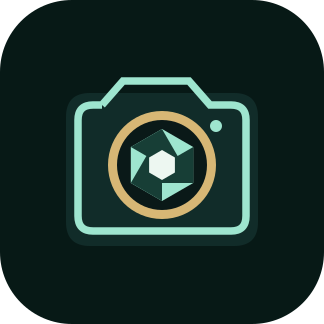

# Langer Câmera — 0.1.10

Câmera Android desenvolvida para testes no Redmi Note 14 4G (24117RN76L), Android 16. Pacote: `br.com.luma.camera`. Sem anúncios, contas ou APIs pagas. Fotos e vídeos são processados no próprio aparelho. A internet é usada pelo atualizador quando solicitado.

## Instalação e atualização

Versões oficiais: https://github.com/Langeresilva/Langer-Camera/releases

- Instalação inicial ou versões anteriores à 0.1.3: baixe o APK ARM64 e abra no Android. Permita câmera e microfone.
- Quem já instalou a 0.1.3 pode atualizar com o pacote `LangerCamera-0.1.3-para-0.1.4.lgrdelta`: abra o app, toque em Verificar atualização, depois Abrir pacote diferencial e selecione o arquivo. Toque em Instalar e confirme no Android.
- A partir da 0.1.4, o canal oficial já vem preenchido. Toque em Verificar atualização para consultar versões futuras. Somente versões publicadas aparecem.
- O Android precisa autorizar o Langer Câmera a solicitar instalação de atualizações. Não há instalação silenciosa.

Canal oficial: `https://github.com/Langeresilva/Langer-Camera/releases/latest/download/latest.json`

## Recursos

Captura frontal e traseira; toque para foco/exposição; fotos com ajuste conservador de iluminação e preservação das cores; somente a foto tratada é publicada na galeria. O envio ao ChatGPT usa essa versão.

Vídeo com áudio quando autorizado, preferência por Full HD a 30 fps, estabilização após a gravação por rastreamento de pontos e suavização da trajetória. O tratamento analisa 15 amostras por segundo, limita deslocamento/rotação e usa zoom 1,25, equivalente a recortar cerca de 20% da largura e da altura visíveis. Se o rastreamento for insuficiente, exporta sem estabilizar. Correção moderada de brilho e cor consistente na sequência.

Os originais e resultados são salvos em Pictures/Langer e Movies/Langer. A notificação permite acompanhar ou cancelar o tratamento. Capturas privadas interrompidas podem ser recuperadas em Recursos e recuperação.

## Limites

O tratamento fotográfico é convencional/adaptativo: não há modelo neural, edição generativa equivalente ao ChatGPT, HDR multiquadro ou reconstrução avançada de detalhes. O giroscópio é detectado, mas não participa da estabilização desta versão.

A estabilização pode deixar tremor residual ou artefatos durante corrida, em baixa luz, com objetos próximos, cenas sem textura, cortes ou movimento dominante. Não remove borrão de movimento. O fabricante pode oferecer recursos privados não acessíveis ao app.

O usuário relatou estabilização aparentemente funcional na versão anterior. As alterações mais recentes e a instalação pelo atualizador ainda exigem validação no Redmi. Comece com vídeos curtos e confira os resultados antes de apagar os originais. Vídeos longos exigem tempo, bateria e espaço para cópias temporárias.

## Compilar

JDK 17, Android SDK/Build Tools 35, Gradle 8.13 e AGP 8.10.1. Android mínimo 13, alvo API 35, com instalação prevista no Android 16. Configure `sdk.dir` em `local.properties` e execute:

```powershell
.\gradlew.bat assembleDebug assembleDebugAndroidTest testDebugUnitTest lintDebug
```

`build.ps1` usa as ferramentas locais em `.tools/` e copia o APK para `entrega/`. Essas pastas são ignoradas pelo Git. A chave local de assinatura deve ser preservada para atualizações compatíveis; não é enviada ao repositório.

## Publicar atualizações

Gere o APK com a mesma chave. `tools/prepare_release.py` prepara o APK, o delta opcional, `latest.json` e hashes. `tools/publish_release.py` envia os assets para uma release inicialmente em rascunho e só a publica depois dos uploads. Detalhes em `updates/PUBLICACAO.md`.

O formato LGRD1 copia trechos do APK instalado e acrescenta os novos para reconstruir o APK assinado exato. Confere hash da base, hash do destino, pacote, versão superior e certificado. Sem um delta compatível, usa o APK completo. Nenhuma mídia é enviada.

## Validação

Quatorze testes JVM aprovados e Android Lint sem erros bloqueantes. APK e delta baixados novamente da release v0.1.4; hashes comparados e reconstrução com o leitor Java validada byte a byte, incluindo assinatura APK. O delta 0.1.3 para 0.1.4 tem 470.010 bytes; o APK tem 40.971.892 bytes.

O teste Android `PipelineInstrumentation` foi compilado, mas não executado: o emulador local não iniciou e o aparelho não está conectado. Não confundir testes JVM ou de bancada com validação completa dos codecs e instalador no celular.

## Componentes

CameraX 1.4.2, Activity 1.10.1, ExifInterface 1.4.1, Media3 1.6.1 e OpenCV 4.12.0. Avisos e licenças em THIRD_PARTY_NOTICES.md e nos assets do APK. Nenhum código ou APK de CapCut foi incorporado.

## Correção fotográfica 0.1.5

Remove o balanço de branco estimado pela média da cena: fundos de cor dominante podiam alterar a pele. Remove saturação forçada e gamma global agressivo. O tratamento aplica o mesmo ganho aos canais RGB, limitado a 12%, para levantar sombras/médios escuros sem modificar cores intencionalmente; preserva áreas claras e cenas bem expostas. Arredondamento, redução de resolução quando necessária e recompressão JPEG ainda podem causar pequenas diferenças. A nova aparência precisa ser avaliada no aparelho. As fotos pessoais fornecidas para diagnóstico não fazem parte do repositório.

## Compartilhar com o ChatGPT — 0.1.6

O botão Enviar ao ChatGPT está na câmera e no comparador. Após confirmação, o Android compartilha a foto original por content URI com permissão temporária de leitura e um pedido de edição. O usuário seleciona o ChatGPT no seletor de aplicativos e confirma a mensagem. Se o receptor ignorar o texto, o diálogo permite copiar o pedido e colar manualmente. O comparador compartilha a original correspondente ao par exibido. Na câmera, usa a original mais recente publicada, mesmo que o tratamento local tenha falhado.

Não há integração com a API da OpenAI, credencial, processamento pago automático ou envio em segundo plano. A edição ocorre no aplicativo receptor e obedece aos limites da conta do usuário. O resultado precisa ser salvo manualmente pelo ChatGPT; não retorna automaticamente ao Langer Câmera. O app não verifica assinatura ou disponibilidade de edição da conta. A captura e o tratamento local permanecem disponíveis.

Compilação, 14 testes JVM e lint aprovados; compartilhamento e recepção de imagem/texto no ChatGPT ainda precisam ser validados no celular.

## Abertura direta — 0.1.7

O envio passa a usar ACTION_SEND direcionado a com.openai.chatgpt, sem criar o seletor de aplicativos no caminho principal. Mantém foto original, texto e permissão temporária de leitura. Se o Android não conseguir abrir esse destino, oferece a seleção manual em um diálogo de alternativa. Não força envio da mensagem dentro do ChatGPT. Compilação, 14 testes JVM e lint passaram; abertura no app receptor ainda depende de teste no aparelho.

## Salvamento único — 0.1.8

Novas fotos são tratadas antes da publicação e somente a versão tratada aparece na galeria. O original temporário privado é removido depois que a tratada é salva com sucesso; em falha ou cancelamento permanece recuperável. O comparador foi removido. O envio ao ChatGPT passa a usar photoTreated. Fotos antigas não são apagadas. Vídeos continuam preservando original e resultado. Compilação, 14 testes JVM e lint aprovados; salvamento único e compartilhamento precisam de validação no aparelho.

## Interface e confirmação de captura — 0.1.9

Visual em verde escuro com detalhes menta e dourado, visor maior e modos Foto/Vídeo sobrepostos ao visor. Novo ícone adaptativo com versão monocromática. Ícones dos controles são desenhados nativamente, sem depender de emojis. Disparador circular distingue foto, gravação e espera; oferece feedback de toque, e um brilho breve e uma confirmação aparecem depois que a câmera confirma o arquivo capturado.

A miniatura provisória é decodificada do JPEG real, com orientação EXIF e memória limitada, e fica identificada como Processando. O arquivo é aberto antes de o serviço poder remover a captura temporária. Quando o tratamento acaba, a miniatura passa a mostrar a mídia publicada na galeria. A galeria aguarda o fim do tratamento para evitar abrir uma captura anterior. Fotos continuam gerando apenas a versão tratada.

Verificar atualização e Recursos e recuperação ficam no menu de controles no canto superior direito. Há uma indicação visual ao tocar no visor para foco. As animações não disparam nova captura nem ligam a lanterna do aparelho.

Compilação, 14 testes JVM e Android Lint sem erros; reconstrução do APK pelo delta e assinatura verificadas. A prévia do ícone abaixo foi renderizada a partir do vetor usado pelo app. O layout, as animações e miniaturas no Redmi ainda precisam de avaliação física; não há aparelho conectado por ADB e o emulador local não iniciou nas tentativas anteriores.



## Pedido editável — 0.1.10

O pedido de edição aparece em um campo de várias linhas antes do envio ao ChatGPT. Pode ser personalizado, copiado e restaurado para o padrão. Salvar pedido e Abrir ChatGPT persistem o texto no aparelho; cancelar descarta a edição. Não permite salvar ou enviar texto vazio. O limite é 4.000 caracteres. O compartilhamento e a opção de copiar usam o texto atualmente editado, inclusive quebras de linha. O menu principal também oferece Editar pedido ao ChatGPT, sem exigir uma foto. Não há chamadas à API.

Compilação, 14 testes JVM e lint aprovados. O APK foi reconstruído pelo delta e teve assinatura verificada. Campo de edição, teclado e recebimento do texto no ChatGPT ainda precisam ser conferidos no Redmi.
